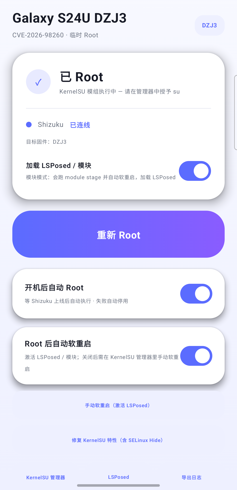
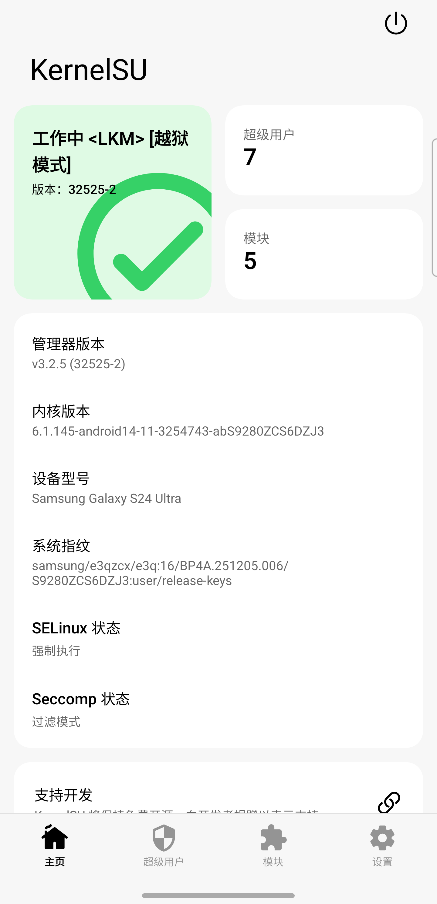
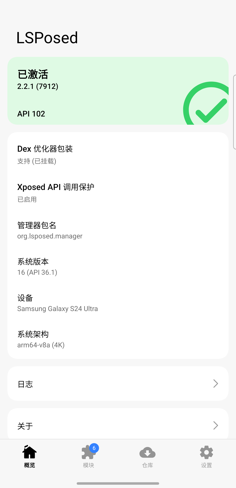

# Galaxy S24U DZJ3 — 临时 Root（源码发布版，不含二进制/ksud）

仅支持 **SM-S9280 国行（CHC）/ e3q / DZJ3**：
`S9280ZCS6DZJ3`，内核 `6.1.145-android14-11-3254743-abS9280ZCS6DZJ3`。

利用 CVE-2026-98260（posix-cpu-timers UAF）获得临时 root：
不写 boot/init_boot、不修改分区、不熔断 KNOX；**真实重启后 root 消失**。

> ⚠️ 本项目用于自有设备的安全研究/测试。使用风险自负；不要用于未授权设备。

## 截图

| App | KernelSU | LSPosed |
|---|---|---|
|  |  |  |

## 这个仓库为什么没有 APK / ksud？

- 本源码仓库不分发 `ksud` 二进制；其来源已定位为 `BuSung-dev/Root-My-Galaxy-Payloads` 的 `kernelsu/ksud-e3q-S9280ZCS6DZF2-kdp`（仓库 Apache-2.0，SHA-256 `1b92611de62035263f129636270deb9002de42e1d2329460342856243975015b`）；
- 预编译的 `libtimer_*.so`、`uhexec` 也不提交，改为从源码构建/自行获取；
- 因此这里只发布**源码、定标数据、构建脚本**。

## 目录
